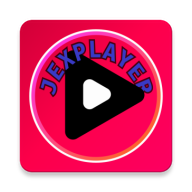

# JexPlayer

### Tu música. Tu espacio.

Un reproductor de música local para Android, de código abierto, con una interfaz minimalista inspirada en la estética japonesa.

  
  
  
  
  

  <em>Un reproductor centrado en tu música local, sin cuentas ni servicios de streaming.</em>

---

## Índice

- [Características](#-características)
  - [Biblioteca e indexación](#biblioteca-e-indexación)
  - [Reproducción](#reproducción)
  - [Diseño y experiencia](#diseño-y-experiencia)
  - [Letras y metadatos](#letras-y-metadatos)
  - [Integración con Android](#integración-con-android)
- [Capturas de pantalla](#-capturas-de-pantalla)
- [Descargar e instalar](#-descargar-e-instalar)
- [Tecnologías](#-tecnologías)
- [Permisos](#-permisos)
- [Estado del proyecto](#-estado-del-proyecto)
- [Contribuir](#-contribuir)
- [Agradecimientos](#-agradecimientos)
- [Licencia](#-licencia)

## 🎉 Características

JexPlayer está diseñado para escuchar la música que ya tienes en tu dispositivo, con una interfaz oscura, sencilla y centrada en la reproducción.

### Biblioteca e indexación

- Selecciona las carpetas de música que quieres incluir mediante el selector de documentos de Android.
- Explora subcarpetas y reúne tus archivos de audio en una biblioteca.
- Busca canciones por título, artista o álbum.
- Filtra la biblioteca por carpeta.
- Consulta las carátulas, los títulos, los artistas, los álbumes y la duración cuando los archivos incluyen esa información.
- Conserva una caché local para acelerar la carga de la biblioteca.

### Reproducción

- Reproducción local mediante AndroidX Media3 y ExoPlayer.
- Controles para reproducir, pausar, avanzar y retroceder.
- Barra de progreso interactiva.
- Reproducción aleatoria.
- Modos de repetición: desactivada, repetir cola y repetir canción.
- Cola de reproducción circular.
- Conservación de la última canción y de la posición de reproducción para facilitar la continuación.
- Reproducción en segundo plano con sesión multimedia y notificación de Android.

### Diseño y experiencia

- Interfaz oscura minimalista con inspiración japonesa.
- Paleta sobria de negro, marfil y carmesí.
- Biblioteca musical con filas compactas y carátulas.
- Mini reproductor persistente dentro de la navegación.
- Pantalla de reproducción completa.
- Transiciones animadas y carátulas con esquinas redondeadas.
- Ajustes para administrar las carpetas de música y actualizar la biblioteca.

### Letras y metadatos

- Lectura de letras incluidas en los archivos de audio cuando están disponibles.
- Visualización de letras sincronizadas en formato LRC.
- Desplazamiento automático hasta la línea correspondiente a la reproducción.
- Toca una línea de la letra para saltar a ese momento de la canción.
- Lectura de etiquetas de audio y metadatos compatibles.

> **Sobre el visualizador:** la animación actual es visual y sintética; no debe interpretarse como un análisis FFT en tiempo real de la señal de audio.

### Integración con Android

- Controles multimedia en la notificación del sistema.
- Sesión multimedia para facilitar la interacción con los controles compatibles de Android.
- Continuidad de la reproducción al salir de la pantalla de la aplicación.
- Selección de carpetas usando el Storage Access Framework (SAF).

## 📱 Capturas de pantalla

Las capturas se añadirán aquí cuando estén preparadas. Se mostrarán imágenes reales de JexPlayer ejecutándose en Android.

<!--
Cuando estén listas, añade las capturas del repositorio, por ejemplo:

  
  
  

-->

## 📥 Descargar e instalar

### JexPlayer para Android

**[Descargar la última versión desde GitHub Releases](https://github.com/Cloudjexp/JexPlayer/releases/latest)**

1. Descarga el APK publicado en la sección de versiones.
2. Abre el archivo APK en tu dispositivo Android.
3. Si Android lo solicita, permite temporalmente la instalación desde esa fuente.
4. Pulsa **Instalar** y abre JexPlayer.

> Si todavía no hay una versión publicada, la sección de versiones puede aparecer vacía. Descarga e instala APK únicamente desde fuentes oficiales del proyecto.

## 🛠️ Tecnologías

| Tecnología | Uso |
|---|---|
| Kotlin | Lenguaje principal |
| Jetpack Compose | Interfaz declarativa |
| Material 3 | Componentes y diseño |
| AndroidX Media3 / ExoPlayer | Motor de reproducción |
| MediaSession | Integración multimedia y reproducción en segundo plano |
| Coil 3 | Carga de carátulas |
| DataStore Preferences | Persistencia de preferencias |
| jAudioTagger | Lectura de etiquetas de audio |
| Gradle | Sistema de compilación |

### Información de la aplicación

| | |
|---|---|
| Paquete | `com.cloudjex.jexplayer` |
| Plataforma | Android |
| Versión mínima | Android 7.0 (API 24) |
| Licencia | MIT |

## 🔐 Permisos

JexPlayer utiliza permisos y mecanismos de Android para acceder a las carpetas que eliges y permitir la reproducción multimedia.

- **Acceso a carpetas:** el selector de documentos de Android permite elegir qué carpetas de música puede explorar la aplicación.
- **Servicio de reproducción multimedia:** permite mantener la reproducción en segundo plano.
- **Notificaciones multimedia:** muestran información de la canción y controles de reproducción cuando el sistema lo permite.

JexPlayer está enfocado en la reproducción de archivos locales. No necesita una cuenta de usuario ni un servidor propio para reproducir tu biblioteca musical.

## 🚧 Estado del proyecto

JexPlayer está en desarrollo. Las funciones descritas reflejan el alcance previsto y documentado del proyecto, pero la disponibilidad puede variar entre versiones.

Algunas áreas, como la gestión completa de listas de reproducción y favoritos, opciones avanzadas de ordenamiento y personalización, pueden seguir pendientes de implementación. Consulta las notas de cada versión para conocer los cambios y limitaciones concretos.

## 🤝 Contribuir

¿Encontraste un error o tienes una idea para mejorar JexPlayer?

- Abre un [issue](https://github.com/Cloudjexp/JexPlayer/issues) para informar de un problema o proponer una mejora.
- Comparte sugerencias con pasos claros y, cuando sea posible, capturas de pantalla.
- Las contribuciones deben respetar el alcance del proyecto y mantener la reproducción local estable.

## 🙏 Agradecimientos

JexPlayer está construido con herramientas y bibliotecas de código abierto. Gracias a sus mantenedores y colaboradores por hacer posible este proyecto.

Si te gusta JexPlayer, puedes apoyar su desarrollo dando una ⭐ al repositorio.

## 📄 Licencia

JexPlayer se distribuye bajo la licencia **MIT**. Consulta el archivo [`LICENSE`](LICENSE) para conocer los términos completos.

---

**Hecho con cuidado para quienes disfrutan su propia música.**

